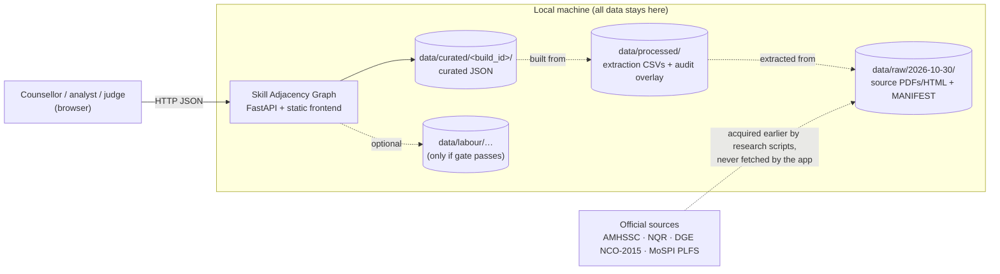
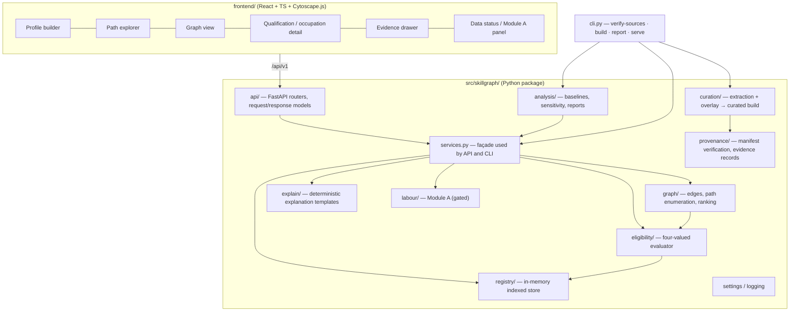
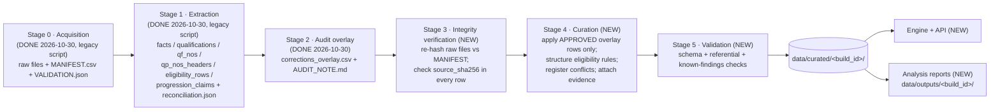
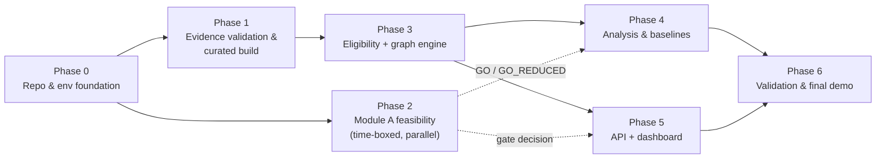

# Skill Adjacency Graph — Architecture

**Project:** Skill Adjacency Graph — *The shortest feasible path from a declining job*
**Competition:** Skillathon 2026 (≈70% data analysis, ≈30% technology/integration)
**Document status:** Approved baseline, 2026-10-31. Updated by the repository-foundation pass. Done: repository hygiene, the pinned `.venv`, the legacy test baseline, the package foundation (settings, logging, CLI stubs) and test infrastructure (`TASKS.md` Phase 0 status). **No business logic is implemented yet.** §8 lists what exists.
**Authority:** this document is authoritative for design, data issues (§8.6) and decisions (§20.2). `API_SPEC.md` is authoritative for the HTTP contract. `TASKS.md` is authoritative for task order, status and acceptance criteria. `README.md` is authoritative for setup commands.
**Companion documents:** [`API_SPEC.md`](API_SPEC.md) (interface contract) · [`TASKS.md`](TASKS.md) (phased implementation plan)

---

## 1. Executive summary

The Skill Adjacency Graph is an evidence-first tool for exploring transitions between vocational qualifications and occupations. For a *hypothetical* worker profile, it will answer:

1. Which qualifications can this person enter?
2. What do official sources say about the entry requirements, training hours and skill units (NOS)?
3. Which multi-step paths exist, and what does each step depend on?
4. Which parts of each answer come from official documents, which are calculated from documented rules, which depend on the person's own declarations or on configurable interpretations, and which are only inference?

The system has two modules:

- **Module B — Skill Adjacency Graph (core, committed).** A deterministic engine for eligibility, graph construction and path enumeration. It is built on four AMHSSC garment qualifications that have already been acquired, extracted and audited. The data model does not assume four records and is not limited to one sector.
- **Module A — Labour-market intelligence (conditional).** Karnataka workforce indicators, for example from PLFS. This module is gated: substantial analysis starts only if a formal **data feasibility gate** (§21) passes. If the gate fails, the product ships as a credible **graph-only** demonstration and states why Module A was deferred.

The architecture is a **Python modular monolith**:

- a FastAPI backend;
- an in-memory registry loaded from a reproducible, hash-verified *curated build* of local data;
- a deterministic eligibility and path engine;
- a small React + TypeScript frontend with Cytoscape.js for the graph view.

It uses no graph database, microservices or LLM-dependent logic. LLMs are an optional explanation-rephrasing extra and never decide eligibility (§15.6).

Every value that the engine or the UI uses carries an **evidence class**: `OFFICIAL`, `RULE_DERIVED`, `DECLARED`, `INFERENCE`, `HYPOTHETICAL` or `CONFIG`. Every eligibility verdict is one of `MET`, `NOT_MET`, `UNKNOWN` or `CONDITIONAL`. Missing, conflicting or uncertain evidence never silently becomes a definitive answer.

---

## 2. Problem statement and target users

### 2.1 Problem

Workers in routine roles have little help working out which qualification is a realistic next step. Official information exists, in Qualification Packs (QPs), Qualification Files (QFs), the National Qualifications Register (NQR) and NCO-2015, but it is spread across many PDFs and web pages and is internally inconsistent in places. It is also written for institutions, not for career guidance.

Typical questions — "Can I enter X?", "How many training hours?", "What do X and Y have in common?" — need someone to:

- read eligibility tables row by row;
- understand NSQF levels;
- notice where the documents disagree.

Existing career tools often present similarity scores as if they were predictions. This project deliberately does not. A graph edge is **not** a promise of employability, placement, higher earnings or a successful transition.

### 2.2 Target users

| User | Need | How the product serves it |
|---|---|---|
| Career counsellor / skill-development officer (primary) | Explore options for a worker they are advising | Profile builder, path explorer, plain-language explanations with evidence |
| Training provider / programme designer | Understand entry rules, NOS overlap and official hours | Qualification detail, NOS comparison, conflict list |
| Policy / labour-market analyst | Understand the occupational context | Module A indicators (only if the gate passes) |
| Data steward / reviewer (internal) | Verify that every claim is traceable | Data-status page, evidence records, conflict register |
| Competition judges (demo audience) | See defensible analysis end to end | A scripted, repeatable demo scenario (§22, `TASKS.md` P6.4) |

Workers can use the tool *with assistance*. It is not designed as an unassisted self-service product, because the relevance declarations (§11) need a careful, honest answer.

---

## 3. Main user journeys

| ID | Journey | Steps | Modules |
|---|---|---|---|
| J1 | **Explore transitions for a hypothetical profile** | Build a profile (age, school grade passed, credentials, held qualifications, per-target declarations) → choose the NSQF interpretation (or leave it unset) → run path exploration → inspect the ranked paths → open the evidence for any step | B |
| J2 | **Check eligibility for one target** | Pick a target qualification → evaluate the profile → see the verdict per eligibility row and per component, what is unknown and why, and what is conditional on what | B |
| J3 | **Inspect a qualification** | Search → open the detail view: official hours breakdown, NOS units, verbatim and structured eligibility rows, progression claims, NCO alignment and its verification status, open conflicts | B |
| J4 | **Compare adjacency** | Open the graph view → see documented edges (shared NOS, progression claims, NCO alignment); optionally reveal experimental inference edges, drawn distinctly | B |
| J5 | **Labour-market context** *(conditional)* | Open an occupation → see Karnataka indicators at the supported aggregation level, with sample-size and uncertainty flags; otherwise see "deferred" and the reason | A |
| J6 | **Audit the data** | Open the data-status page → see the build ID, source hashes, validation checks, unresolved conflicts and unavailable sources | Both |

---

## 4. Scope, non-goals and assumptions

### 4.1 In scope

- Curating the existing extracted evidence for the four pilot qualifications into a versioned, validated source-of-truth dataset, with field-level provenance.
- A generic, data-driven model of qualifications, NOS units, eligibility rules, occupations, sources and conflicts.
- Deterministic eligibility evaluation with four-valued verdicts and explicit conditions.
- Documented overlap (exact NOS codes), official progression claims (display only) and NCO alignment.
- Experimental inference edges that are labelled, off by default and excluded from feasibility.
- Multi-step path enumeration and ranking with transparent sort keys and deterministic explanations.
- Reproducible analytical outputs: interpretation-sensitivity matrices, baseline comparisons and an uncertainty audit (§13.5, `TASKS.md` Phase 4).
- A Module A feasibility assessment, followed by either minimal indicators or a documented deferral.
- A local web demo.

### 4.2 Non-goals

- Job matching, placement, vacancy search, wage prediction or demand forecasting.
- Automated recognition of prior learning (RPL), exemptions or equivalence decisions.
- Storing real people's data, user accounts or authentication.
- Acquiring new data from inside the application. Any further acquisition is a separate, approved research step.
- Public hosting of restricted source content.
- LLM-generated eligibility, evidence or statistics.

### 4.3 Assumptions (explicit)

| ID | Assumption | Consequence if wrong |
|---|---|---|
| AS-1 | The 2026-10-30 acquisition, extraction and audit outputs (§8) are the evidence base for the pilot. Re-acquisition is not needed. | Phase 1 re-validates the hashes. A mismatch blocks the curated build. |
| AS-2 | The demo runs locally on the developer machine (Windows 11, Python 3.12.5, Node 23). | Docker is a COULD (§15.7). |
| AS-3 | Reuse and redistribution permissions for the AMHSSC, NQR and DGE documents are **unconfirmed**. | All data and derived datasets stay out of Git. Public sharing of derived tables waits for confirmation (§19). |
| AS-4 | All profiles are hypothetical and declared by the user. No profile is persisted. | — |
| AS-5 | School-grade requirements ("8th grade pass") are satisfied by a higher grade passed. This follows the audit overlay's rule-derived constraints (e.g. OV-005, OV-007). | It is reviewable in `eligibility_rules_review.md` (P1.5). If rejected, the curated rule structuring changes to an exact comparison, with no engine code change (Q-9). |
| AS-6 | There is no default for the NSQF "Level X" interpretation (audit decision D3). | If it is unset, level components evaluate to `UNKNOWN`. |

---

## 5. The two modules and how they fit together

```
Module B (committed)                          Module A (gated)
────────────────────                          ────────────────
Qualifications ─ NOS ─ Eligibility            Karnataka indicators by
      │                                       occupation group (if feasible)
      └── ALIGNED_TO_NCO ──► NCO-2015 occupation ◄── joined at the supported
                              (8-digit code)          NCO aggregation level
```

- **The join key is the NCO-2015 code** that each QF states. Module A indicators can only be joined at the level the labour-market data supports, which is probably 1–3 digits (§14). The UI will always state that level, for example: "context for NCO division 8 (Plant and machine operators), not specific to this qualification".
- **Module A never changes eligibility, feasibility or path existence.** In v1 it does not enter ranking either. It is shown as context beside occupations and path targets. This prevents employment *levels* from being read as hiring *demand*.
- **"Declining job" in the title.** An occupation is labelled declining only if Module A passes the gate and the criterion in §14.4 is met. Otherwise the starting point is described neutrally as "your current role or qualification", and the README and demo say why.

---

## 6. System context and components

### 6.1 System context



### 6.2 Components (modular monolith)



**Dependency rules**, enforced by code review and an import-boundary test (`TASKS.md` P3.10):

- `eligibility/` and `graph/` import only `model/` and `registry/`. They never import `api/`, `labour/` or any LLM client.
- `labour/` never imports `eligibility/` or `graph/`.
- `curation/` is the only code that reads `data/processed/` extraction outputs. The application reads `data/curated/` only.
- No new code imports the legacy scripts in `data_acquisition/` or `data_extraction/`. Their file names contain hyphens and dates, and they are frozen research tools.
- `tools/` holds standalone repository tools that are not part of the `skillgraph` package. It currently contains `check_legacy_baseline.py` (§18). Package code never imports from `tools/`.

---

## 7. Data acquisition, validation, transformation and analytical flow



Principles:

1. **Raw data is immutable.** No stage writes to `data/raw/` or to existing `data/processed/*` folders. New outputs go to new folders: `data/curated/`, `data/outputs/` and `data/labour/`.
2. **Overlay, never overwrite.** The audit overlay sits beside the extraction CSVs. Curation reads both. A curated record keeps the `source_value` and, separately, any applied overlay value with its `overlay_id`. Overlay rows with status `PROPOSED_CORRECTION` or `PROPOSED_REPRESENTATION` are applied **only** if they are listed in `config/overlay_approvals.yaml`, which records the user's approval.
3. **Fail closed on integrity.** If a raw file's SHA-256 does not match `MANIFEST.csv`, or an extraction row's `source_sha256` does not match its file, the build stops (`SourceIntegrityError`).
4. **Deterministic build.** Inputs are sorted, JSON keys are sorted and content timestamps are excluded. `data_build_id` = `cb-` + the first 12 hex digits of the SHA-256 over (input file hashes, approvals file hash, curation-code version, relevant config). Build metadata, including wall-clock time, is kept in a separate `build_manifest.json`.
5. **No re-acquisition.** Expanding to more qualifications later needs a new, approved acquisition run under the same discipline: robots.txt, throttling, a manifest, hashes and privacy screening. It is never done by the application.

---

## 8. Existing research artifacts (from inspection on 2026-10-31)

### 8.1 Repository state

| Item | Observed state |
|---|---|
| Branch / HEAD | Working branch `chore/repo-foundation`, created from `main` at `3362d87` (the single commit, which tracks only `.gitignore`). The foundation files are committed (`fbdc28f`, `63a83dd`; P0.4 pending): `TASKS.md` Phase 0. The remote `origin` is private. |
| Ignored | `data/` (all raw and processed data); `.venv/`; caches. The legacy code directories are no longer ignored (RS-2). |
| Python | The global interpreter is Python 3.12.5. It is used only to create `.venv`. The **global package set is inconsistent** (`pip check`: fastapi 0.115.6 requires starlette < 0.42, but 0.46.2 is installed) and is **not used** by the project (RS-7). The project runs in an isolated `.venv` installed from the hashed `requirements-lock.txt` (§15; commands in `README.md`). |
| Other tools | Node 23.0.0 / npm 10.9.0 (frontend, P5.7); Docker 29.9.2 (COULD); uv 0.11.32, a standalone binary used only to regenerate the lock file |
| Project documents | `README.md`, `ARCHITECTURE.md`, `API_SPEC.md`, `TASKS.md`, `docs/baselines/legacy_tests_2026-10-31.md`. The research reports under `data/` (`ACQUISITION_REPORT.md`, `RECONCILIATION_REPORT.md`, `AUDIT_NOTE.md`) are frozen evidence, never edited. |

### 8.2 Discrepancies against the described state

| # | Discrepancy found by inspection | Resolution (foundation pass, 2026-10-31) |
|---|---|---|
| RS-1 | `.gitignore` began with `@'` and ended with `'@ \| Set-Content -Path ".gitignore" -Encoding utf8`. This was PowerShell wrapper text saved into the file. | **Resolved.** Both lines were removed (P0.1). |
| RS-2 | `/data_*/` ignored `data_acquisition/` and `data_extraction/`, so the acquisition script, extraction script and reconciliation test had no Git history. | **Resolved.** The rule was removed, `/data/` still ignores all data, and the three legacy files are committed (`fbdc28f`). They stay where they are, because their scripts compute `ROOT` from their own location. |
| RS-3 | `*.html` would ignore the future Vite entry point `frontend/index.html`. | **Resolved.** `!/frontend/index.html` was added. The file does not exist yet; it is created in P5.7. |
| RS-4 | `*.csv` is ignored globally. | **Kept by design.** Synthetic test fixtures use JSON/YAML (§18). |
| RS-5 | `ACQUISITION_REPORT.md` says "Not a Git repository". | Historical: Git was initialized after acquisition. No action. |
| RS-6 | Audit decision D6 recorded the reconciliation tests as *provisional* (a pytest stand-in). | **Closed.** Real pytest (8.4.2 global; 9.2.0 in `.venv`): **23 passed, 1 failed (DQ-01, unresolved; checked against an exact baseline)**. Recorded in `docs/baselines/legacy_tests_2026-10-31.md`. This is not a passing suite (§18). |
| RS-7 | The global Python environment is inconsistent (fastapi 0.115.6 with starlette 0.46.2). | **Resolved.** The project uses an isolated `.venv` with no system site-packages (P0.2). |
| RS-8 | The planned pin fastapi 0.115.6 forces starlette 0.41.3, which has 14 published advisories in OSV, including CVE-2025-62727 (fixed in 0.49.1). pytest 8.4.2 has CVE-2025-71176 (fixed in 9.0.3). | **Resolved.** Pins updated to fastapi 0.162.0 (resolves starlette 1.10.0) and pytest 9.2.0. An OSV query reports 0 advisories for all 30 locked packages (P0.2). |

### 8.3 Artifact inventory and reuse decision

All paths are relative to the repository root. Every **data** item below is **ignored by Git and local-only**. The three legacy code files are versioned as of the foundation pass (`fbdc28f`), with the content reviewed under §19.

| Artifact | What it is | Reuse decision |
|---|---|---|
| `data_acquisition/acquire_2026-10-30.py` (809 lines) | Phased acquisition CLI (`p1 \| parse \| p2 \| cross \| p3 \| outputs`): robots.txt checks, per-host throttle, hashing and validation. Uses httpx, pypdf and bs4. | **Freeze.** Do not re-run. Keep it as provenance for how the raw files were obtained. Its conventions are the template for any future approved acquisition. |
| `data_extraction/extract_2026-10-30.py` (1010 lines) | pdfplumber-based extraction of QF Sections 1–2, QP headers and NOS parameter blocks, with per-value PII screening. Writes `data/processed/extracted_2026-10-30/`. | **Freeze.** Its outputs are the input to curation. Known issues (audit A1): the status counts exclude age rows, and report lines are truncated at 260 characters. Do not patch it. The validation stage computes its own counts. |
| `data_extraction/test_reconcile_2026-10-30.py` | 24 reconciliation test cases over the CSVs (mostly parametrised per qualification), including a PII-pattern test. | **Frozen regression suite**, never edited and not collected by the default `testpaths`. Current result: **23 passed, 1 failed (DQ-01, unresolved; checked against an exact baseline)** by `tools/check_legacy_baseline.py` against `docs/baselines/legacy_tests_2026-10-31.md`. |
| `data/raw/2026-10-30/MANIFEST.csv` | 22 items: source URL, retrieval time, HTTP status, SHA-256, validation status | **Source registry.** Source IDs (`A1`…`D2`) become stable `src:` identifiers. |
| `data/raw/2026-10-30/VALIDATION.json`, `_state.json` | Per-field validation, gates, NCO search outcomes, cross-checks | Read for NCO verification status and cross-check outcomes |
| `data/raw/2026-10-30/ACQUISITION_REPORT.md` | Narrative of the run, failures and discrepancies | Cited in the data-status page and the claims register |
| Raw sources (18 files, ≈7 MB): 4 QPs, 5 QFs (two Inline Checker copies), AMHSSC catalogue HTML + PDF, 2 NQR record HTML pages, the NCO-2015 landing page and a DGE NCO table page, 3 robots.txt | Original documents. **These contain personal contact details** (per `ACQUISITION_REPORT.md` §12). | Never served by the API, never committed, never displayed. Only extracted values with page references are used. |
| `data/processed/acquisition_2026-10-30/approved_qualifications_parsed.csv` | 37 AMHSSC catalogue rows (code, NQR code, NSQF level, notional hours, credits, QP/QF URLs) | Catalogue cross-check. It is also the **candidate list for expansion**, but expansion needs new acquisition of each QF. There is one encoding artifact in a title (row 27). |
| `data/processed/extracted_2026-10-30/*.csv`, `reconciliation.json`, `RECONCILIATION_REPORT.md` | facts (164 rows, 37 fields), qualifications (4 + 1 secondary), qf_nos (33), qp_nos_headers (25), eligibility_rows (24 rows + 4 age rows + secondary copy), progression_claims (7), and the reconciliation checks | **Primary curation input.** Use `reconciliation.json` rather than the report, because the report truncates lines and its counts are off by one (audit A1). |
| `data/processed/audit_2026-10-30_m1s1/corrections_overlay.csv` + `AUDIT_NOTE.md` | 52 overlay rows (OV-001…OV-052) with `category`, `status`, `engine_use`, `engine_constraint` and `decision_ref`; decisions D1–D6 | **Authoritative interpretation layer** for the engine. `engine_use` maps directly onto engine behaviour (§11.4). |

### 8.4 Pilot qualifications as recorded in the existing artifacts

These are values from the extraction outputs (QF item 13 hours, item 9c age), shown here for orientation only. The curated build will re-derive them with evidence.

| QP code | Name (QF) | NSQF | Min. age | Official notional hours (T / P / OJT-m / total) | NCO-2015 (stated) | NCO title verified? |
|---|---|---|---|---|---|---|
| AMH/Q0301 | Sewing Machine Operator | 2.5 | 18 | 90 / 210 / 0 / 300 | 8153.0101 | Yes (DGE table p.5) |
| AMH/Q2301 | Specialized Sewing Machine Operator | 3.5 | 18 | 150 / 270 / 0 / 420 | 8153.0103 | Yes (DGE table p.5) |
| AMH/Q0103 | Inline Checker – Sewing | 3.5 | 18 | 150 / 240 / 30 / 420 | 7543.0301 | Yes, as "Measurement Checker" (DGE table p.5) |
| AMH/Q2101 | Production Supervisor – Sewing | 5 | 20 | 180 / 330 / 60 / 570 | 3122.3551 | **No.** Not found in DGE pages 0–9; the NCO Vol I PDF returned 404. |

### 8.5 Inspection observation on documented overlap (OBS-01)

From the extracted QF NOS tables, the exact NOS codes shared between pilot qualifications are:

- Specialized Sewing Machine Operator ∩ Inline Checker = {AMH/N0309, DGT/VSQ/N0102};
- Inline Checker ∩ Production Supervisor = {DGT/VSQ/N0102};
- Specialized Sewing Machine Operator ∩ Production Supervisor = {DGT/VSQ/N0102};
- **Sewing Machine Operator shares no NOS code with the other three.**

All shared units are labelled Non-Core. This is an inspection observation, not an engine output. Phase 3 must reproduce it with a test (`TASKS.md` P3.4).

**Methodological consequence:** for this pilot, documented overlap is thin and generic (employability, safety). The defensible core of the analysis is therefore eligibility plus official hours plus official progression claims. Overlap is a supporting attribute, not the ranking driver. Core-skill similarity could only come from inference, and PC/KU text was deliberately not extracted, for privacy and scope reasons.

### 8.6 Known data-quality issues (carried forward, unresolved unless stated)

| ID | Issue | Evidence | Engine treatment |
|---|---|---|---|
| DQ-01 | **SSMO credits conflict.** QF NOS rows sum to 12, while the QF totals row and item 10 say 14. N2302 credits: QF 3 vs QP 5. | OV-036…039, decision D1; the legacy test `test_credit_sums_equal_item10[AMH/Q2301]` fails (`assert 12.0 == 14.0`), recorded in `docs/baselines/legacy_tests_2026-10-31.md` | Credits are `NOT_USED`. They are displayed with an `UNRESOLVED_SOURCE_CONFLICT` flag. No value is selected. The new suite registers the exact values in `config/known_deviations.yaml` (`TASKS.md` P1.6). |
| DQ-02 | **DGT/VSQ/N0102 NSQF level in SSMO.** QF 3.5 vs QP 4. | OV-040 | `DISPLAY_ONLY`, with a conflict flag. Not used for any comparison. |
| DQ-03 | **SSMO bridge/N2301 hours.** The QF shows bridge 3 h + N2301 147 h. A prior lead said the NQR record states 150 h, but that record (acquisition item C3) returned HTTP 404, so the comparison was **not performed**. | `ACQUISITION_REPORT.md` §8; reconciliation `lead_specialized_n2301_150h_conflict: NOT PERFORMED` | The QF hours are used (QF item 13 totals reconcile with the NOS sums). The detail view shows the open lead with the flag `SOURCE_UNAVAILABLE`. It is not treated as a conflict, because no conflicting value is held locally. |
| DQ-04 | **Production Supervisor NCO title.** 3122.3551 was not found in the searched DGE pages, and the NCO Vol I PDF returned 404. | VALIDATION.json `nco` | The occupation node is shown with `title_verification: NOT_FOUND` and no title is invented. The QF-stated code is `OFFICIAL`; the title is absent. |
| DQ-05 | QP AMH/Q0103 is titled "Checker – Inline & Measurement", while the QF and catalogue say "Inline Checker – Sewing". | `ACQUISITION_REPORT.md` §7 | Both titles are kept as aliases with their sources. The QF title is used for display. |
| DQ-06 | The two Inline Checker QF copies have different SHA-256 values but identical extracted text on all 24 pages. | Audit §1, reconciliation | The NQR copy (B2) is primary. The AMHSSC copy (B2b) is corroboration only. |
| DQ-07 | SSMO item 9 has a merged experience cell. Rows 2–4 have an empty experience value. | OV-002…004 (`PROPOSED_CORRECTION`) | These rows stay `UNKNOWN` until the user approves the overlays. Even after approval, their academic part is unresolved. |
| DQ-08 | SSMO NOS table has a S.No. gap: 6 is missing, and no row is missing. | OV-041 | Display only |
| DQ-09 | SSMO eligibility row 5 reads "10th Grade pass work" (stray word). | OV-015, decision D4 | The education component is `UNKNOWN`. The experience part is evaluated. |
| DQ-10 | The catalogue "QP Version" may mean the NQR version. | reconciliation `SEMANTIC_AMBIGUITY` | Display only |
| DQ-11 | The reconciliation report's counts are off by one and its lines are truncated. | Audit A1 | The validation stage recomputes the counts. |
| DQ-12 | One printed credit value covers the bridge row plus the first core NOS (SMO, SSMO). | OV-034/035 (`PROPOSED_REPRESENTATION`) | Credits are `NOT_USED`. Grouping is shown only if approved. |
| DQ-13 | SMO QP and QF approval and review dates differ. QP "Last Reviewed On" is later than approval. | `ACQUISITION_REPORT.md` §7 | Display only |
| DQ-14 | The NQR records for Inline Checker and Production Supervisor (C1, C2) lack the NSQF level in their HTML text. The SSMO and SMO NQR records (C3, C4) are unavailable. | `ACQUISITION_REPORT.md` §4–5 | Shown in the source list with `SOURCE_UNAVAILABLE` where applicable |
| DQ-15 | Progression-claim titles do not exactly match catalogue titles. Example: "QC Executive – Sewing Line" vs catalogue "QC Executive – Stitched Items". "Sampling Coordinator" does match by name (AMH/Q1801). | Inspection | Claims are `DISPLAY_ONLY` text. A name-based link to a catalogue code is `INFERENCE` and needs review. It is never an `OFFICIAL` edge. |

---

## 9. Source-of-truth data model and stable identifiers

### 9.1 Identifier scheme

The scheme rests on official codes. Every entity has an `id` of the form `<kind>:<official-key>`, and API paths use a URL-safe `slug`.

| Kind | `id` example | Key source | `slug` (URL) |
|---|---|---|---|
| Qualification | `qual:AMH/Q0301` | QP code | `AMH.Q0301` (`/` → `.`) |
| NOS unit | `nos:DGT/VSQ/N0102` | NOS code | `DGT.VSQ.N0102` |
| Non-NOS module (e.g. bridge) | `mod:AMH/Q0301/S1` | QP code + printed S.No. | `AMH.Q0301.S1` |
| Occupation | `nco:8153.0101` | NCO-2015 code | `8153.0101` |
| Source document | `src:A3` | MANIFEST `item_id` | `A3` |
| Eligibility rule row | `rule:AMH/Q2301/E9` | QP code + printed S.No. | — |
| Age rule | `rule:AMH/Q2301/AGE` | QP code | — |
| Progression claim | `claim:AMH/Q0301/P2` | QP code + claim number | — |
| Conflict | `conflict:OV-036` | Lowest overlay ID in the conflict group | — |
| Evidence record | `ev:3f9c1a…` (16 hex) | SHA-256 of (source id, page, record key, field) | same |
| Curated build | `cb-1a2b3c4d5e6f` | §7 principle 4 | — |

A slug is a lookup key only and is never parsed back into a code. The build fails if two slugs collide.

### 9.2 Core entities

These are Pydantic models in `src/skillgraph/model/`. Their API projections are in `API_SPEC.md` §2.

```text
SourceDocument   id, manifest_item_id, title, org, url, retrieved_at, sha256, file_type, pages,
                 validation_status, licence_status (UNCONFIRMED | PERMITTED | RESTRICTED), role (PRIMARY | SECONDARY)

Evidence         id, evidence_class, source_id?, page?, location?, method?, extraction_status?,
                 overlay_ids[], decision_refs[], derived_from[] (evidence ids, for RULE_DERIVED),
                 declared_field? (for DECLARED), config_key? (for CONFIG), note

Qualification    id, code, slug, coverage (CURATED | CATALOGUE_ONLY), nqr_code, titles{qf, qp?, catalogue?},
                 awarding_body, sector,
                 nsqf_level (Valued), min_age (Valued), hours (HoursBreakdown), credits (Valued, NOT_USED),
                 nco_codes[] (Valued), version_info{...display only}, nos_memberships[], modules[],
                 eligibility (EligibilitySpec), progression_claims[], quality_flags[]

Valued<T>        value: T | null, evidence_id, status (TRANSCRIBED | PARSED_UNCERTAIN | UNRESOLVED |
                 CORROBORATED | CONFIRMED_BY_GEOMETRY | CORRECTION_APPLIED), engine_use, conflict_id?

HoursBreakdown   theory, practical, ojt_mandatory, ojt_recommended, total — each Valued<float>

NosUnit          id, code, titles_by_source{qualification_id: title}, (no level here — level is per membership)

NosMembership    qualification_id, nos_id | module_id, s_no, core_or_noncore, nsqf_level (Valued),
                 version (Valued, display), hours (HoursBreakdown), credits (Valued, NOT_USED), is_bridge

EligibilitySpec  age_rule: AgeRule, rows: EligibilityRow[]   — semantics: AND(age, OR(rows))
EligibilityRow   id, s_no, raw_text (verbatim), components[] (AND), engine_use, overlay_ids[], flags[]
Component        type (AGE_MIN | SCHOOL_GRADE_MIN | NAMED_CREDENTIAL | PRIOR_NSQF_LEVEL |
                 EXPERIENCE_MIN_YEARS | UNMODELLED), params{...}, requires_relevance: bool,
                 or_equivalent: bool, evidence_id, safe: bool, unknown_reason?

Occupation       id, nco_code, title?, title_verification (VERIFIED_IN_SOURCE | NOT_FOUND | NOT_CHECKED),
                 evidence_id?, nco_levels{division, sub_division, group, family}  (derived from the code)

ProgressionClaim id, qualification_id, text_verbatim, direction_label, resolved_target_id? (only via
                 reviewed INFERENCE), engine_use = DISPLAY_ONLY

Conflict         id, subject (entity id + field), values[{value, evidence_id}], status
                 (UNRESOLVED_SOURCE_CONFLICT | UNRESOLVED_LEAD_SOURCE_UNAVAILABLE), decision_ref?, engine_effect
```

### 9.3 Storage format

Curated data is written to `data/curated/<build_id>/` as one JSON file per entity collection, plus `evidence.json`, `conflicts.json`, `build_manifest.json` and `validation_report.json`, and a human-readable `eligibility_rules_review.md`. The data is small (dozens of records), so JSON is diff-friendly and needs no database. SQLite or Parquet would only be considered if Module A microdata needs it (§15.3).

---

## 10. Graph: nodes, edges and evidence classes

### 10.1 Evidence classes (used everywhere)

| Class | Meaning | Examples | May it make a step feasible? |
|---|---|---|---|
| `OFFICIAL` | Explicitly documented by a source | QF item 13 hours; eligibility row text; stated NCO code; NOS membership | Yes, as rule *input* |
| `RULE_DERIVED` | Calculated from documented rules and values | Shared-NOS sets; summed path hours; school grade ≥ requirement (per overlay) | Yes |
| `DECLARED` | Supplied by the hypothetical profile | Age; grade passed; relevant years; relevance declarations | Yes, but the verdict becomes `CONDITIONAL` when a judgement-type declaration (relevance) is needed |
| `INFERENCE` | Heuristic or similarity estimate | NCO unit-group proximity; title similarity; name-matched progression target | **Never** |
| `HYPOTHETICAL` | Illustrative scenario; not an entitlement or verified result | "If shared NOS were not re-trained"; "assume completed intermediate qualifications are relevant" | Only inside an explicitly enabled scenario, and the path is then labelled `HYPOTHETICAL` |
| `CONFIG` | Configurable assumption or policy choice | `nsqf_level_match = at_least`; max path length | Yes; any verdict depending on it lists the config key |

### 10.2 Nodes

| Node type | Source | Notes |
|---|---|---|
| `QUALIFICATION` | Curated build | The only node type that paths traverse. Only `coverage = CURATED` records (full QF evidence) can be path targets. `CATALOGUE_ONLY` records (catalogue row only; the other 33 AMHSSC qualifications) are listed for orientation, with level and notional hours from the catalogue, and have no eligibility data. |
| `CLAIM_TEXT` | Progression claims (QF item 15) | Display node holding verbatim claim text; it never participates in paths |
| `NOS_UNIT` / `MODULE` | Curated build | Shown in detail and graph views |
| `OCCUPATION` | NCO codes stated in QPs/QFs | Title present only if verified |
| `PROFILE_STATE` | Request-scoped, never stored | The start of path enumeration |

### 10.3 Edges

| Edge type | Direction | Class | Stored or computed | Used for feasibility? |
|---|---|---|---|---|
| `INCLUDES_NOS` | qual → nos/module | OFFICIAL | Stored | No (supports hours and overlap) |
| `SHARES_NOS` | qual ↔ qual | RULE_DERIVED (exact code match on OFFICIAL memberships) | Stored | **No.** Annotation and an optional sort key. Carries `shared_codes[]`, `core_shared_count`, `version_agreement` (`SAME`, `DIFFERENT` or `NOT_STATED`) and any conflict IDs. |
| `PROGRESSION_CLAIM` | qual → claim text (→ qual only via reviewed inference) | OFFICIAL text; link INFERENCE | Stored | **No** (audit decision D2, OV-032: never upgrades a verdict) |
| `ALIGNED_TO_NCO` | qual → occupation | OFFICIAL | Stored | No |
| `ELIGIBILITY_ROUTE` | profile state → qual | RULE_DERIVED over OFFICIAL + DECLARED + CONFIG | **Computed per request** | **Yes.** This is the only feasibility edge. |
| `NCO_GROUP_PROXIMITY` | qual ↔ qual | INFERENCE (experimental) | Stored, hidden by default | No |
| `TITLE_SIMILARITY` *(COULD)* | qual ↔ qual | INFERENCE (experimental) | Stored, hidden by default | No |

**Invariant:** a path exists only through `ELIGIBILITY_ROUTE` edges. Inference edges can annotate a path but can never create, remove or reorder feasibility. A dedicated test checks this: toggling inference must leave path sets and verdicts unchanged (`TASKS.md` P3.6).

What documented overlap measures: the share of formally identical NOS units, by code, between two qualifications. What it **does not** measure: transferability of skills, equivalence of competence, exemption entitlement, or whether people actually move between the roles.

---

## 11. Eligibility evaluation and uncertainty propagation

### 11.1 Verdict lattice

Verdicts are totally ordered: `NOT_MET < UNKNOWN < CONDITIONAL < MET`.

- **AND** (components in a row; age with rows) = **minimum**.
- **OR** (alternative rows) = **maximum**.
- **Target verdict** = `AND(age_rule, OR(row₁ … rowₙ))`.

This gives the required semantics:

- One definite failure in a conjunction fails it (`AND(NOT_MET, UNKNOWN) = NOT_MET`).
- An unknown never becomes a pass (`AND(UNKNOWN, MET) = UNKNOWN`).
- A conditional route beats an unknown one (`OR(CONDITIONAL, UNKNOWN) = CONDITIONAL`).

| Verdict | Meaning shown to the user |
|---|---|
| `MET` | Satisfied by declared factual inputs against official rules whose engine use is `SAFE_HARD_RULE` / `SAFE_WITH_CONSTRAINT`, with no judgement-type declaration or config interpretation needed |
| `CONDITIONAL` | Satisfied **only if** the listed declarations (e.g. "your 3 years of experience are relevant to this role") and/or config interpretations (e.g. `nsqf_level_match = at_least`) hold. It is never presented as verified. |
| `UNKNOWN` | The evidence or the profile is insufficient: the input was not declared, the rule is unmodelled or ambiguous, the source is uncertain or in conflict, or the config is unset. The reasons are listed. |
| `NOT_MET` | A safe rule is definitively failed by a declared value (e.g. age 17 < 18) |

### 11.2 Component evaluation rules

| Component | Inputs | Evaluation |
|---|---|---|
| `AGE_MIN` (item 9c, `SAFE_HARD_RULE`) | `profile.age_years` | ≥ min → MET; < min → NOT_MET; missing → UNKNOWN (`INPUT_NOT_DECLARED`) |
| `SCHOOL_GRADE_MIN` | `profile.school_grade_passed` (0–12) | ≥ required → MET (RULE_DERIVED per overlay, AS-5); < required → NOT_MET; missing → UNKNOWN. "Grade 9" without "pass" (decision D5): grade 9 or higher passed → MET; otherwise UNKNOWN, not NOT_MET. |
| `NAMED_CREDENTIAL` (e.g. "UG Certificate") | `profile.post_school_credentials` (list or null) | Held → MET. Declared list without it: if `or_equivalent` → UNKNOWN (`EQUIVALENCE_UNDEFINED`); if not `or_equivalent` and no other post-school credential → NOT_MET; if other credentials are held → UNKNOWN (`CREDENTIAL_ORDER_UNDEFINED`). Null → UNKNOWN. "12th or Equivalent": grade 12 passed → MET; otherwise UNKNOWN (open question Q-3, §20). |
| `PRIOR_NSQF_LEVEL` (level L, "relevant") | held qualification codes (official levels) + externally declared levels; `config.nsqf_level_match`; per-target relevance declaration | Applied in order: (1) holdings not declared → UNKNOWN. (2) Holdings declared as none → NOT_MET; no interpretation question arises. (3) Config unset → UNKNOWN (`CONFIG_UNSET`, decision D3), **even if the outcome would be the same under both interpretations**; P4.1 reports such interpretation-invariant cells separately. (4) No held or declared qualification satisfies L under the config → NOT_MET. (5) A satisfying qualification that is declared relevant → CONDITIONAL; declared not relevant → NOT_MET; relevance undeclared → UNKNOWN. |
| `EXPERIENCE_MIN_YEARS` (Y, relevant) | per-target `relevant_experience_years` | Y = 0 → MET. Declared ≥ Y → CONDITIONAL (relevance is declared, not verified; decision D2). Declared < Y → NOT_MET. Undeclared → UNKNOWN. |
| `UNMODELLED` | — | Always UNKNOWN, with a reason code: `ENROLMENT_NOT_MODELLED` (pursuing schooling), `LITERACY_NOT_MODELLED` ("ability to read and write"), `NTC_NAC_CITS_NOT_MODELLED`, `DIPLOMA_YEAR_NOT_MODELLED`, `REVIEW_FLAG` (decision D4) |

### 11.3 Uncertainty propagation

1. **Uncertain inputs cap results.** A component whose official input value is `PARSED_UNCERTAIN`, and has not been confirmed by geometry, corroborated, or corrected through an approved overlay, evaluates to UNKNOWN, whatever the profile says. The flag is `UNCERTAIN_EXTRACTION`. Likewise, a value that is missing from the extraction and exists only through a pending, unapproved overlay proposal (for example the SSMO rows 2–4 experience, OV-002…004) evaluates to UNKNOWN with `OVERLAY_NOT_APPROVED`.
2. **Conflicts cap results.** A component that depends on a value with an open conflict evaluates to UNKNOWN (`SOURCE_CONFLICT`). With the current data, no eligibility component depends on a conflicted value: the conflicts concern credits and one NOS level, and both are display-only.
3. **Conditions accumulate.** A CONDITIONAL verdict carries `conditions[]`. Each condition is `{kind: DECLARATION | CONFIG | HYPOTHETICAL, key, value, evidence_class}`, collected from the winning route(s). The UI phrases these as "This holds only if …".
4. **Unknowns are explained.** Each UNKNOWN carries `unknown_reasons[]`, each with a code, the row/component ID and a human message. The UI lists "What would resolve this": declare X, set config Y, or "not resolvable from current sources".
5. **Nothing is invented.** The engine contains no rule for NSQF equivalence, experience relevance, "equivalent" qualifications, NOS or training exemptions, RPL, reduced hours, or any condition not supported by a source plus the overlay.

### 11.4 Mapping audit `engine_use` to engine behaviour

| Overlay `engine_use` | Engine behaviour |
|---|---|
| `SAFE_HARD_RULE` | The component is evaluated normally and can be MET or NOT_MET |
| `SAFE_WITH_CONSTRAINT` | Evaluated only within `engine_constraint`, which curation translates into structured params and reviews in `eligibility_rules_review.md`; outside it → UNKNOWN |
| `SAFE_HOURS` | Hours may be used in path totals |
| `CONDITIONAL_ON_DECLARED_RELEVANCE` | Education and years are hard; relevance is DECLARED, so the best result is CONDITIONAL; undeclared → UNKNOWN |
| `…+LEVEL_CONFIG` | Additionally requires `nsqf_level_match`; unset → UNKNOWN |
| `UNKNOWN` | Only the affected component is UNKNOWN. Safe sibling components are still evaluated (e.g. OV-002: the experience part is safe), so a definite failure elsewhere still yields NOT_MET. |
| `DISPLAY_ONLY` | Shown, never computed |
| `NOT_USED` | Never read by the engine. This applies to all credits. |

### 11.5 Worked logic (illustrative, not results)

Take SSMO row 9: "Previous relevant Qualification of NSQF Level 2.5 ‖ 3 year relevant experience". The components are `PRIOR_NSQF_LEVEL(2.5, relevant)` AND `EXPERIENCE_MIN_YEARS(3, relevant)`.

A profile holds AMH/Q0301 (official level 2.5), sets `nsqf_level_match = exact`, and declares that AMH/Q0301 is relevant and that it has 3 relevant years. The row is then `CONDITIONAL`, with conditions [relevance of AMH/Q0301 (DECLARED), relevance of 3 years (DECLARED), `nsqf_level_match = exact` (CONFIG)]. The official progression claim SMO → SSMO (OV-032) is shown beside it as supporting evidence and does not change the verdict.

The audit's rule-derived notes (A4) become regression tests, not demo claims:

- The level part of Production Supervisor row 4 (level 4) cannot be met from any pilot qualification under either interpretation.
- A Sewing Machine Operator holding meets the *level* part of SSMO row 9 and Inline Checker row 4 under either interpretation.

---

## 12. Official training hours versus incremental retraining estimates

| Quantity | Class | Definition | Where it is shown |
|---|---|---|---|
| **Official notional hours** of a qualification | OFFICIAL | QF item 13: theory, practical, OJT mandatory, OJT recommended and total. Overlay status `SAFE_HOURS`. Bridge-module hours are included as printed. | Detail view; every path step |
| **Path official hours** | RULE_DERIVED | The sum of the full official totals of each qualification entered on the path. | Path totals; default "shortest" sort key |
| **Hypothetical incremental hours** | HYPOTHETICAL | Shown only if `scenario.incremental_hours_policy` ≠ `NONE`. It is the target's official total minus the official hours of target NOS units whose code (`EXCLUDE_SHARED_NOS_CODE`) or code+version (`EXCLUDE_SHARED_NOS_CODE_AND_VERSION`) the profile holds, through declared or hypothetically completed qualifications. Bridge modules and units with conflict flags are never deducted. | A separate column with the banner "Illustrative only — no source grants exemption from these units" |
| **Evidence-backed incremental hours** | OFFICIAL (future) | Only if an official source defines a reduced route, such as an RPL or bridge programme with stated hours. **No such source is in the current evidence**, so the field is always `null` with the flag `NO_OFFICIAL_REDUCTION_SOURCE`. | — |
| **Credits** | OFFICIAL, `NOT_USED` | NSQF credits are displayed with their conflict flags. They are **never** converted to hours or used for effort (decision D1). | Detail view only |

Official hours measure the documented notional training duration of a full qualification. They do **not** measure an individual's actual learning time, the calendar time to complete, cost, availability of training places, or time to employment.

---

## 13. Path enumeration, ranking and explanation

### 13.1 Enumeration

- **Start state:** a `PROFILE_STATE` built from the declared profile (held qualifications, credentials, grade, age, declarations).
- **Step:** for every qualification not yet held, evaluate eligibility against the current state. Keep the step if the verdict ≠ `NOT_MET`. Keep `NOT_MET` steps only if `include_blocked = true`; they are shown in a "blocked, and why" section and are never ranked.
- **State update (hypothetical):** after a step, the target is added to the held qualifications *as hypothetically completed*, with the evidence class `HYPOTHETICAL`.
  - Experience does **not** accrue unless `scenario.assumed_experience_gain_years_per_step > 0`. The default is 0, and any non-zero value marks the path `HYPOTHETICAL`.
  - Relevance of a hypothetically completed qualification for later targets must be declared. The alternative is `scenario.assume_intermediate_relevance = true`, which also marks the path `HYPOTHETICAL`.
- **Search:** bounded depth-first enumeration of simple paths (no repeated qualifications), with `max_steps` (default 3, hard limit 4, both CONFIG). Neighbours are expanded in ascending `qualification_id` order, so the results are deterministic. The registry is small, so enumeration is exhaustive within the bound. Before enumerating, a guard estimates n^k and refuses with `LIMIT_EXCEEDED` if the expansion would exceed `paths.max_expansions` (CONFIG).
- **Path verdict:** `AND` over its steps, so the path inherits its weakest step. Conditions and unknown reasons are the union over its steps, de-duplicated.

### 13.2 Ranking (transparent sort keys, no opaque score)

Ranking is lexicographic, and each key is visible in the response (`sort_values`):

1. **Path verdict class**: always first (`MET` > `CONDITIONAL` > `UNKNOWN`).
2. **The selected `sort_by` key**: default `OFFICIAL_HOURS`. The alternatives are `STEPS`, `ASSUMPTIONS`, `QUALITY_FLAGS` and `DOCUMENTED_OVERLAP`.
3. **Fixed tie-breakers**: the keys from assumptions → steps → quality flags → official hours, in that order and excluding the selected key, and finally `path_id`, for determinism.

| Key | What it measures | What it does **not** measure |
|---|---|---|
| Path verdict | How fully the path's entry rules are satisfied by the declared profile and documented rules | Likelihood of admission, completion, employment or earnings |
| `ASSUMPTIONS`: count of conditions + unknown reasons | How many assumptions or gaps the path rests on | Their importance or probability |
| `OFFICIAL_HOURS`: path official hours | Documented notional training duration of the qualifications entered | Personal effort, cost, calendar time, or the hypothetical reduction from overlap |
| `STEPS`: step count | The number of qualification transitions | Difficulty of each transition |
| `QUALITY_FLAGS`: count of uncertain extraction, conflicts and unavailable sources touched | How much the path relies on weaker evidence | The quality of the outcome |
| `DOCUMENTED_OVERLAP`: `SHARES_NOS` count between consecutive steps, descending | Formally identical units between consecutive steps | Skill transferability or equivalence (§10.3) |

"Shortest feasible path" is defined as **the path with the best verdict class and, within it, the least total official notional hours**, which is the default ranking. This is a documented-duration measure, not a prediction. No weighted composite score is offered in v1. If one is ever added, its weights are CONFIG and shown on screen.

### 13.3 Explanations

Explanations are produced by **deterministic templates** in `explain/`, not by an LLM. Each explanation is a list of `ExplanationItem {text, evidence_class, evidence_ids[], flags[]}`. Example item types:

- **Verdict summary:** "Conditional: holds only if you confirm …".
- **Per-row reasoning:** which route succeeded, which failed and why.
- **Hours statement**, with the source page.
- **Overlap statement:** "shares 2 NOS units (both Non-Core): AMH/N0309, DGT/VSQ/N0102".
- **Progression-claim statement:** "QF item 15 lists … (supporting evidence only)".
- **Caveats:** always included: "This is not a prediction of employability, placement or earnings."

### 13.4 Inference (experimental, off by default)

| Inference | Measures | Does not measure | Status |
|---|---|---|---|
| `NCO_GROUP_PROXIMITY`: two qualifications whose stated NCO codes share a unit group (4 digits) or minor group (3 digits) | Classification proximity of the *occupations* the qualifications align to | Skill overlap; feasibility; mobility | SHOULD, labelled "Experimental" |
| `TITLE_SIMILARITY`: token or embedding similarity of NOS titles | Lexical resemblance of unit titles | Competence equivalence | COULD; only if time allows; never on PC/KU text |
| Name-matched progression target: normalised text match of a claim to a catalogue title | That two strings likely name the same qualification | That the official pathway is endorsed | SHOULD, reviewed in `eligibility_rules_review.md` |

### 13.5 Baselines (Phase 4)

These compare *what different simple approaches would suggest* against the eligibility-aware engine. They do **not** measure "accuracy": there is no ground truth of successful transitions.

| Baseline | Suggests a move A → B when … |
|---|---|
| B0 Official progression | A's QF item 15 names B |
| B1 NSQF ladder | B's level > A's level |
| B2 Documented overlap | A and B share ≥ 1 NOS code |
| B3 NCO proximity (inference) | The NCO unit groups match |
| Engine | The eligibility verdict is not `NOT_MET` under a stated profile and config |

The outputs are agreement and disagreement tables with reasons. For example: a "progression claim present but eligibility `UNKNOWN` because row X is unmodelled", or "overlap present but level requirement `NOT_MET`". Also produced: **interpretation sensitivity** (verdict changes between `exact`, `at_least` and unset), **declaration sensitivity**, and an **UNKNOWN-cause audit** (which rows and reasons drive the unknowns). These analyses carry most of the "data analysis" weight while making no claims beyond the evidence.

---

## 14. Labour-market indicators (Module A — gated)

### 14.1 Candidate sources (none verified for this repository)

| Source | Likely use | Unverified points to establish at the gate |
|---|---|---|
| PLFS unit-level data (MoSPI) | Karnataka employment by occupation, industry, status, earnings | Access terms (registration), reuse rights, rounds available, NCO version used per round (possibly not NCO-2015; a concordance may be needed), state identifier, weights and design variables, Karnataka sample sizes by occupation |
| PLFS published reports / state tables | Validation targets and simple state-level context | Table availability for Karnataka; definitions |
| Karnataka Economic Survey | Sector context (e.g. textiles and garments) | Table provenance, definitions, years, licence |
| NCO-2015 | Classification hierarchy for joins | The Vol I PDF returned 404 earlier; the online table was only partially searched |

### 14.2 Indicator definitions (apply only if GO)

Each indicator records its definition, its reference period, and the employment activity status used: usual status (ps+ss) or current weekly status (CWS), always stated.

- **Employment estimate** (weighted count) and **occupation share** of employed persons, by NCO aggregation level supported (likely 1-digit division, possibly 2-digit).
- **Worker population ratio / LFPR**, for Karnataka, used as a validation anchor against published figures.
- **Earnings:** mean or median monthly earnings for regular wage/salaried workers, by occupation group, only where the cell meets the thresholds. Self-employed earnings are kept separate (they are CWS-based in PLFS).
- **Industry mix** (NIC section) for the garment-related groups, if supported.

### 14.3 Quality checks and suppression

- **Reproduce a published figure first.** Example: the Karnataka WPR from the official PLFS report for the same round, within a tolerance stated in config. If this fails, the gate fails.
- **Cell thresholds** (CONFIG, decided and justified in Phase 2): a minimum unweighted sample count per cell, and a maximum relative standard error. Cells failing either threshold are suppressed (`SMALL_SAMPLE`) and not shown as numbers.
- **Uncertainty** is reported as confidence intervals when design variables allow design-based variance. If they do not, uncertainty is marked `UNCERTAINTY_NOT_ESTIMABLE` and no comparative claims are made.

### 14.4 Claim discipline

| Distinction | Rule |
|---|---|
| Employment level vs hiring demand | PLFS measures who is employed, not vacancies. Never label anything "in demand" from PLFS. |
| Historical trend vs forecast | Only historical comparisons; no forecasts. |
| Employment or earnings vs vacancies | Vacancy data is out of scope unless a verified source passes its own gate. |
| Observed vs inferred | Joining an indicator to a qualification through NCO aggregation is `INFERENCE` (context), labelled as such. |
| Robust vs small-sample | Suppressed or flagged per §14.3. |
| "Declining" | Allowed only if ≥ 2 rounds use comparable definitions and classification, both cells pass the thresholds, and the 95% CI of the change in share excludes 0. Otherwise the UI says "no defensible trend". |

---

## 15. Technology choices

| Concern | Choice | Why | Trade-off accepted |
|---|---|---|---|
| Language (data + engine) | Python 3.12 (`requires-python = ">=3.12,<3.13"`) | The existing research is in Python; strong data tooling | — |
| Dependency management | `pyproject.toml` (exact pins for direct dependencies; extras `dev`, `analysis`) + `requirements-lock.txt` (uv-compiled, universal, with SHA-256 hashes for all 30 packages). Installed with `pip --require-hashes --no-deps` into an isolated `.venv`. | Reproducible and verifiable installs on any platform; the global environment is not trusted (RS-7) | uv is needed only to *regenerate* the lock; installation needs only pip |
| Domain and API models | Pydantic 2.12.5 | One schema source for curation validation, the engine and the API (OpenAPI generated automatically) | — |
| Backend | FastAPI 0.162.0 (Starlette 1.10.0) + Uvicorn 0.34.0 | Typed contracts, automatic OpenAPI for the frontend, minimal boilerplate. The version was chosen to avoid the starlette advisories (RS-8). | Slightly more setup than Streamlit |
| Graph / paths | Plain Python adjacency + bounded DFS (≈100 lines) | The graph is tiny; hand-written code is fully transparent and deterministic; no dependency in the core | networkx is **not** a dependency. Add it to the `analysis` extra only if a concrete analysis needs it. |
| Storage | File-based curated JSON; in-memory registry at startup | Dozens of records; reproducible; diffable; no server | Must re-build after a data change (seconds) |
| Module A data | pandas (+ Parquet if microdata volume warrants it; already gitignored) | Standard and sufficient | Adding pyarrow would be a new dependency (approval needed) |
| Frontend | Vite + React + TypeScript | Polished, componentised UI; typed against the OpenAPI schema; Node 23 is present | A second toolchain. Streamlit was considered and rejected: weaker control of the layout, the evidence drawer and graph interaction, and it would bypass the API contract. |
| Graph visualisation | Cytoscape.js | Built for network graphs; styling by edge type (solid for documented, dashed for inference); built-in layouts | — |
| Explanations | Deterministic templates | Reproducible and testable; cannot fabricate | Less fluent prose |
| Configuration | YAML (`config/*.yaml`) + env override `SKILLGRAPH_CONFIG` | Human-readable assumptions | — |
| Tests | pytest 9.2.0 + httpx 0.28.1 (FastAPI TestClient), in the `dev` extra; Vitest for frontend logic if time allows | Pinned and locked | — |

### 15.6 Optional LLM use (COULD; never on the critical path)

An optional "rephrase in plain language" action can send the **already computed** structured explanation to an LLM and return prose, labelled "AI-rephrased; see the evidence for the authoritative version". Constraints:

- It receives no raw source text and no profile fields beyond what the explanation contains.
- It is never used to compute verdicts, hours, edges or statistics.
- It is disabled when no API key is configured.
- The deterministic text is always visible.
- If it is ever implemented, it uses the current Claude models.

### 15.7 Docker (COULD)

Docker is a convenience for the demo machine only. An image must **not** bundle `data/`. It mounts the local data directory at runtime. It is only attempted after the Phase 6 local demo works.

---

## 16. API boundaries and data contracts

- **HTTP boundary** (frontend ↔ backend): versioned under `/api/v1`, JSON, stateless, read-only except for POST *evaluations*. POST is used because profiles are request bodies, and nothing is persisted. The full contract is in `API_SPEC.md`.
- **Internal boundary:** ordinary Python calls through `skillgraph.services` (`API_SPEC.md` §4). The CLI, analysis scripts and API all use the same façade, so reports and UI show identical numbers.
- **Contract source of truth:** the Pydantic models in `src/skillgraph/api/schemas.py`. The OpenAPI document is generated from them. TypeScript types are generated from OpenAPI (SHOULD) or hand-mirrored and checked by a contract test.
- **Every analytical response** includes `meta.data_build_id` and `meta.config_digest`, so any screenshot or report can be traced to an exact build and configuration.

---

## 17. Configuration, error handling, logging and reproducibility

| Area | Design |
|---|---|
| Configuration | Committed YAML files, which contain no secrets:<br/>• `config/default.yaml`<br/>• `config/overlay_approvals.yaml`: approved overlay IDs, with approver and date<br/>• `config/known_deviations.yaml`: registered source discrepancies, P1.6<br/>• `config/labour_market.yaml`: the Module A gate decision<br/>• `config/demo/*.yaml`: hypothetical demo profiles, clearly labelled<br/><br/>Engine interpretation keys (`nsqf_level_match`) have **no default** and are null in `default.yaml`. They can be set per request. Every response echoes the effective config and its digest.<br/><br/>**Environment variables (the complete list):**<br/>• `SKILLGRAPH_CONFIG`: path to the settings YAML; default `config/default.yaml`<br/>• `SKILLGRAPH_DATA_ROOT`: root of the local data tree; default `data/`<br/>No secrets are required. The optional LLM key (§15.6) would be the only one, and it would be read from `.env`, which is gitignored. |
| Error handling | Domain exceptions (`SourceIntegrityError`, `CurationError`, `NotFoundError`, `ValidationError`, `ModuleUnavailableError`, `LimitExceededError`) map to the error envelope in `API_SPEC.md` §1.6. The app starts in a degraded mode if no valid curated build exists: health is OK, status is `NOT_BUILT`, and data endpoints return `503 DATA_NOT_BUILT`. **An UNKNOWN verdict is not an error.** |
| Logging | stdlib `logging` with a JSON-lines formatter to stderr. Each request logs `request_id`, route, status and duration. **Profile contents are never logged**, only a SHA-256 digest of the canonical profile JSON. The build logs input hashes and the counts of applied overlays. `*.log` is already gitignored. |
| Reproducibility | Deterministic curated build (§7). The analysis CLI writes outputs to `data/outputs/<build_id>/` with a run manifest: config digest, code commit, input build ID. Re-running produces byte-identical tables. This is a test (`TASKS.md` P4.6, P6.2).<br/>Python dependencies: `pyproject.toml` (direct pins) and `requirements-lock.txt` (complete hashed lock). The procedure is in `README.md` § Setup.<br/>Frontend dependencies: `frontend/package-lock.json` (P5.7). |

---

## 18. Testing strategy

| Layer | What | How |
|---|---|---|
| Legacy regression | The frozen reconciliation suite (24 cases), never edited | `tools/check_legacy_baseline.py` runs it unmodified and requires an **exact** match with `docs/baselines/legacy_tests_2026-10-31.md` (outcomes, failure assertion, input hashes). Current result: **23 passed, 1 failed (DQ-01, unresolved; checked against an exact baseline)**. **This is not a passing suite.**<br/>Any additional or changed failure, changed value, or disappearance of the DQ-01 failure without a reviewed resolution is a deviation (exit 1). `--self-test` verifies this detection. Not part of the default `testpaths`; wrapped as a test in P0.4. |
| Known deviations (new suite) | Registered source discrepancies, starting with DQ-01 | `config/known_deviations.yaml` plus tests (`TASKS.md` P1.6):<br/>• an unregistered discrepancy fails;<br/>• a registered one must match its recorded values exactly;<br/>• a registered one that changes or disappears fails until it is reviewed. |
| Unit: logic | The verdict lattice (exhaustive AND/OR truth tables over 4 values) | Pure functions |
| Unit: components | Each component type × {met, not met, undeclared, config unset, uncertain input, conflict} | **Synthetic JSON fixtures** with obviously fictional codes (`TEST/Q9001`), never shown in the demo |
| Unit: hours / credits | Path hour sums; mutating any credit value leaves all engine outputs unchanged | Property-style test |
| Golden (real local data) | Audit-derived expectations: PS row 4 level part unattainable from the pilot; SMO meets the level part of SSMO row 9 and IC row 4 under both interpretations; config unset → UNKNOWN; OBS-01 overlap sets; DQ-01/02 conflicts registered; 3122.3551 title `NOT_FOUND` | Marked `@pytest.mark.requires_local_data`; skipped (not failed) if `data/` is absent |
| Integrity | Raw hashes vs MANIFEST; every curated `OFFICIAL` value has a source, SHA and page | Build-time checks + tests |
| Invariants | Inference toggling never changes path sets or verdicts; deterministic ordering; no NOT_MET path ranked | Tests over the real build |
| Privacy | The existing PII regexes run over curated JSON, analysis outputs and recorded API responses | Reuses the legacy test's patterns |
| Contract | Every endpoint's example in `API_SPEC.md` validates against the Pydantic models; error envelopes | FastAPI TestClient |
| Import boundaries | `eligibility/` and `graph/` don't import `api/`, `labour/` or LLM clients | AST-based test |
| Frontend | Verdict badge mapping, evidence-class labels, "unavailable" states | Vitest (SHOULD) + manual demo checklist |
| Module A (if GO) | Reproduction of a published figure; suppression thresholds | Tests against the saved published values |

---

## 19. Privacy, source licensing and data governance

- **Restricted until confirmed.** All raw and derived data (`data/**`) stays local and ignored. This includes curated JSON and analysis tables derived from the sources, because their redistribution rights are unconfirmed. `SourceDocument.licence_status` defaults to `UNCONFIRMED`. The data-status page shows it.
- **Personal information.** The raw PDFs contain contact details of named people (SPOC annexures). The existing extraction deliberately never read those pages. The new code never opens raw PDFs. It reads only the extraction CSVs. The PII pattern test runs on all outputs. Planning documents and the UI contain no personal information.
- **Profiles** are hypothetical, request-scoped and never stored or logged in clear text.
- **Committing.** Only code, configuration, documentation and synthetic fixtures are committed. A hygiene check (`TASKS.md` P6.3) fails if `git ls-files` contains `data/` paths or `.pdf/.csv/.html/.xlsx` files, except the allow-listed `frontend/index.html`.
  - **Reviewed exception.** The legacy scripts and the project documents contain short official facts: qualification and NOS codes, hours, credits, NCO codes, minimum ages, short eligibility phrases, and one three-word assessment-criterion fragment. They also contain public source URLs. The documents also contain SHA-256 hashes of local data files, which identify files without revealing content. This content was reviewed in the foundation pass and accepted for the **private** repository. Making the repository public requires the reuse-rights question (AS-3) to be settled first.
- **Attribution.** The UI and README cite source organisations and document titles. Embedding source documents or long verbatim passages waits for licence confirmation. Short factual values (codes, hours, level numbers, eligibility row text) are shown with page references, for local demo use.
- **Future acquisition** (Module A, or more qualifications): it needs explicit approval, must follow the robots.txt and throttle discipline of the 2026-10-30 run, and needs a fresh manifest.

---

## 20. Risks, unresolved questions and assumptions

### 20.1 Risk register

| ID | Risk | Likelihood | Impact | Mitigation |
|---|---|---|---|---|
| R-01 | PLFS access, terms or Karnataka sample sizes are inadequate | Medium–High | Module A deferred | Feasibility gate (§21), time-boxed; graph-only fallback is fully designed |
| R-02 | Thin documented overlap (OBS-01) makes the overlap story weak | Certain (pilot) | Medium | Lead with eligibility, hours and claims; present overlap honestly as a finding; expansion as a SHOULD |
| R-03 | **UNKNOWN inflation**: many rows are unmodelled or "or equivalent", so many verdicts are UNKNOWN | High | Demo looks indecisive | The UNKNOWN-cause audit turns this into an analytical finding; "what would resolve this" hints; the user decides Q-3 and Q-4 |
| R-04 | Licensing blocks public sharing of derived tables | Medium | Presentation limits | Local demo; aggregate statements with citations; seek confirmation early |
| R-05 | Pending overlay approvals (OV-002…004, OV-034/035) | Certain until decided | Low | Unapproved overlays → UNKNOWN or display only; there is no blocking dependency |
| R-06 | A legacy script or data gets accidentally committed after the `.gitignore` fix | Low | High (restricted data) | Pre-commit scan (P0.1); hygiene check (P6.3) |
| R-07 | Scope creep (expansion, LLM, Docker) delays the core demo | Medium | High | MUST/SHOULD/COULD discipline in `TASKS.md`; critical path defined |
| R-08 | Frontend toolchain issues on Windows | Low | Medium | Fallback: FastAPI serves a minimal static page; the API and analysis remain demonstrable |
| R-09 | Judges read edges as recommendations or predictions | Medium | High (credibility) | Caveat on every path; evidence classes visible; no composite "score" |

### 20.2 Decision register (authoritative)

`TASKS.md` refers to this table; it does not keep its own copy. **None of the open decisions blocks the first implementation task (P0.3).** Each open decision has a safe default that keeps the result `UNKNOWN` or unapplied, so none of them can produce a false `MET`.

| ID | Question | Status | Effective behaviour | Affects |
|---|---|---|---|---|
| Q-1 | Fix `.gitignore` and version the legacy scripts (RS-1/RS-2)? | **Resolved** 2026-10-31 | Applied and committed on `chore/repo-foundation` (`fbdc28f`). | P0.1 |
| Q-2 | Approve or reject OV-002…004 (SSMO merged-cell experience) and OV-034/035 (credit groups)? | Open | Not applied. The affected values are `UNKNOWN` (`OVERLAY_NOT_APPROVED`) or display-only. | P1.3 |
| Q-3 | "Xth or Equivalent" / "UG Diploma or equivalent": is a declared *lower* school grade with no post-school credential `NOT_MET` instead of `UNKNOWN`? | Open | `UNKNOWN` (`EQUIVALENCE_UNDEFINED`) | P1.5, P3.2 |
| Q-4 | Model "Ability to read and write", "pursuing schooling", NTC/NAC/CITS and diploma-year routes as declared inputs (audit open item 5)? | Open | `UNKNOWN` (unmodelled) | P1.5 |
| Q-5 | How is the legacy test result recorded? | **Resolved** 2026-10-31 | "23 passed, 1 failed (DQ-01, unresolved; checked against an exact baseline)". It is not accepted as passing. See `docs/baselines/legacy_tests_2026-10-31.md`. This closes audit decision D6. | P0.5, P1.6 |
| Q-6 | Register for PLFS microdata access, and which rounds? | Open | Module A `NOT_ASSESSED`, so the graph-only demo applies | P2.1 |
| Q-7 | Expand beyond four qualifications (needs a new approved acquisition)? Candidates: Sampling Coordinator (AMH/Q1801), QC Executive – Stitched Items (AMH/Q1401), Sewing Machine Operator Knits (AMH/Q0305). | Open | Pilot of 4 | Backlog B-1 |
| Q-8 | Competition deadline and demo format (live, recorded, slides)? | Open | Effort ranges only | Scheduling |
| Q-9 | Is school-grade "at least" (AS-5) acceptable as rule-derived? | **Resolved by default** | Adopted, because the audit overlay already states it (OV-005, OV-007). It is reversible in the P1.5 rule review without code changes. | P1.5, P3.2 |
| Q-10 | Create `.venv` and install pinned dependencies? | **Resolved** 2026-10-31 | Isolated `.venv` installed from the hashed lock; `pip check` is clean | P0.2 |
| F-1 | Dependency pins | **Resolved** 2026-10-31 | fastapi 0.115.6 → 0.162.0 and pytest 8.4.2 → 9.2.0, because of published advisories (RS-8). The other planned pins are unchanged. | P0.2 |
| F-2 | Lock and install tooling | **Resolved** 2026-10-31 | `uv pip compile --universal --generate-hashes` produces `requirements-lock.txt`. Installation uses `pip install --require-hashes --no-deps`. The project itself is installed editable from P0.3. | P0.2, P0.3 |
| F-3 | Keep `!/frontend/index.html` before the frontend exists? | **Resolved** 2026-10-31 | Kept. It is harmless now, and it prevents P5.7's entry point from being silently ignored. | P5.7 |

---

## 21. Data feasibility gate (Module A) and graph-only fallback

### 21.1 Gate criteria

Each criterion is recorded as `PASS`, `FAIL` or `UNKNOWN`, with evidence.

| ID | Criterion | Evidence required |
|---|---|---|
| FG-1 | **Access:** the data files are actually obtained through an official channel | Saved terms and access record; file hashes in a new manifest |
| FG-2 | **Lawful reuse:** the terms permit this analysis and displaying aggregates in the competition | Quoted terms clause; licence status |
| FG-3 | **Variables:** state, occupation code (with its NCO version and digits), industry, activity status, earnings, weights, design variables | Codebook extract (variable list only) |
| FG-4 | **Karnataka identification:** state code present and documented | Codebook |
| FG-5 | **Sample adequacy:** at the intended NCO level, enough Karnataka cells meet the thresholds (§14.3) to support at least the garment-relevant groups | A table of unweighted counts (counts only, not estimates) |
| FG-6 | **Comparability:** at least two rounds share definitions and classification, or a documented concordance exists | Documentation references |
| FG-7 | **Understanding:** weights and estimation are understood; one published Karnataka figure is reproduced within tolerance | Reproduction notebook/script output |
| FG-8 | **Join:** the pilot NCO-2015 codes map to the available occupation level | Mapping table, classed as INFERENCE where aggregation is involved |

### 21.2 Outcomes

| Outcome | Condition | Product behaviour |
|---|---|---|
| `GO` | FG-1…FG-8 PASS | Indicators + optional trend labels (§14.4) |
| `GO_REDUCED` | FG-1–4, 7 PASS; FG-5/6/8 partially | Single-round, division-level context only; no trend labels |
| `NO_GO` | FG-1, FG-2 or FG-7 FAIL, or the time-box expires | Module A deferred; `GET /labour-market/status` returns the reasons; UI panel says "deferred — see the decision record" |
| `NOT_ASSESSED` | Gate not run yet | Same UI as `NO_GO`, with a different reason |

**Time-box:** 1–2 working days of effort, excluding any wait for access approval. The decision is written to `docs/decisions/MODULE_A_GATE.md` and to `config/labour_market.yaml` (`gate_decision`).

### 21.3 Graph-only fallback

The fallback is the **default plan**, not a degraded afterthought. Journeys J1–J4 and J6 are fully delivered by Module B. The demo narrative becomes:

> "Here is what official documents let us say about moving between these qualifications. Here is exactly where the evidence runs out. Here is why we did not add labour-market claims we could not defend."

---

## 22. Phased roadmap

Details, checkpoints and acceptance criteria are in [`TASKS.md`](TASKS.md).



| Phase | Outcome | Rough effort |
|---|---|---|
| 0 | **Done:** `.gitignore` fixed, foundation files committed, `.venv` from the hashed lock, legacy test baseline check, package skeleton/config/logging (P0.3), test harness (P0.4, commit pending). | Done |
| 1 | Integrity verification, schemas, curated build with evidence and conflicts, validation report | 1.5–3 days |
| 2 | Module A gate decision (parallel; may end in `NO_GO`) | 1–2 days + access wait |
| 3 | Eligibility engine, graph, paths, ranking, explanations, golden tests | 2.5–4 days |
| 4 | Sensitivity, baselines, UNKNOWN audit, hours analysis, reproducible reports | 1–2 days |
| 5 | FastAPI endpoints, React UI, graph view, evidence drawer, Module A panel | 2.5–4 days |
| 6 | Full verification, hygiene and licence check, demo script, claims register | 1–1.5 days |

**Critical path:** P0 → P1 → P3 → (P4 ∥ P5) → P6, roughly 9–15 working days. Phase 2 runs alongside and never blocks the demo.
